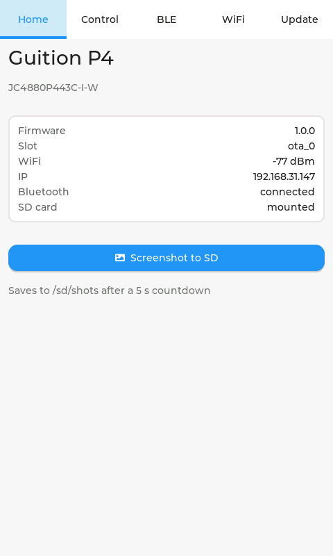
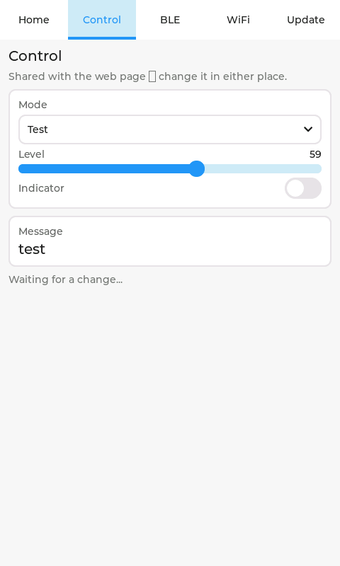
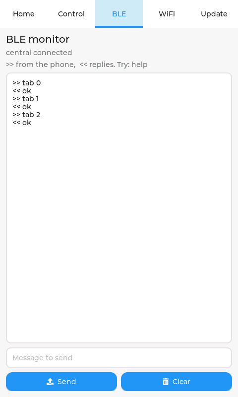
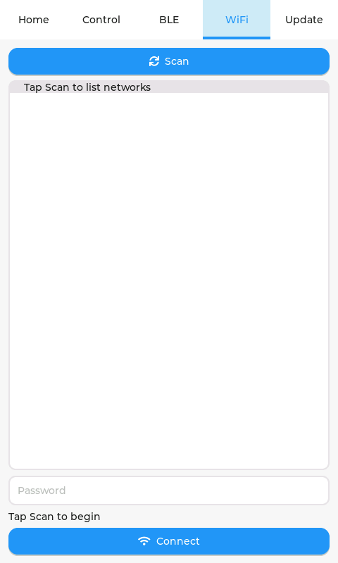
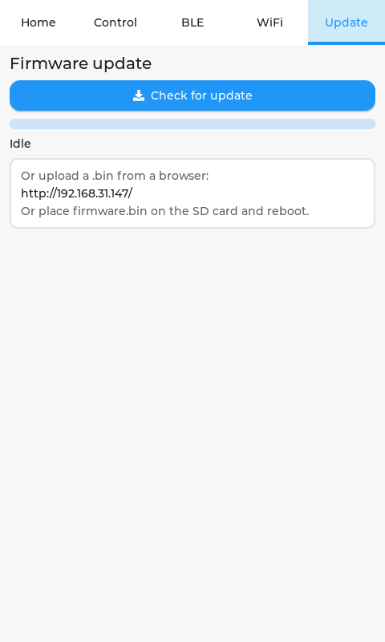

# Gution P4 — student guide

[](https://github.com/giltal/ESP32P4_Guition4_7_Project/releases/latest)
[](LICENSE)

A 4.3" touchscreen board (ESP32-P4 + ESP32-C6) that you can control from **three places at once**:
the screen itself, a **web page**, and **Bluetooth** from a phone or PC. Change something in one
place and the other two follow immediately — that shared state is the thing to play with.

> Building or modifying the firmware? See **[CLAUDE.md](CLAUDE.md)** for the engineering notes.

---

## First switch-on

1. Power the board over USB. The screen comes up in a few seconds.
2. If it has never been on your WiFi, it creates its own network called **`gution-setup-XXXX`**.
   Join it from a phone; a setup page should open by itself. Pick your WiFi, enter the password.
3. The board reconnects on its own next time — passwords are remembered on the SD card.

The **Home** tab shows the IP address once it is online. Type that address into a browser on the
same network to reach the web page.

---

## The five tabs

### Home — what the board is doing



Firmware version, which slot it booted from, WiFi signal and IP address, Bluetooth state, and
whether an SD card is present. Everything here updates by itself once a second.

**Screenshot to SD** saves a picture of the screen to `/sd/shots/`. It counts down five seconds
first, so you can switch to the tab you actually want to photograph. The screenshots in this guide
were made that way.

| Bluetooth says | Meaning |
|---|---|
| `advertising` | ready for a phone or PC to connect |
| `connected` | something is connected |
| `unavailable` | the radio did not start — see Troubleshooting |

---

### Control — the shared state



Four values that live in one place and are visible from everywhere:

| | |
|---|---|
| **Mode** | Idle, Run or Test |
| **Level** | a number from 0 to 100 |
| **Indicator** | on or off |
| **Message** | short piece of text |

Change any of them here, and the web page and any connected Bluetooth app update straight away.
Change them from *there*, and this tab follows. The line at the bottom tells you where the last
change came from.

Values survive a power cycle — they are saved to the SD card a few seconds after you stop
fiddling.

**Try this:** open the web page on a laptop and this tab on the board, and move the slider on one
while watching the other.

---

### BLE — the Bluetooth console



A live view of Bluetooth traffic. `>>` is what a phone or PC sent; `<<` is what the board replied
or sent.

Type in the box and tap **Send** to push a message *to* the connected app. **Clear** empties the
view.

Anything you type in a Bluetooth terminal appears here immediately — even without pressing Enter —
so it is the quickest way to see whether your app is really talking to the board.

Commands the board understands:

```
status         show everything
mode <0|1|2>   Idle / Run / Test
level <0-100>
led <on|off>
msg <text>     changes the Message on the Control tab
tab <0-4>      switch which tab is showing
help
```

---

### WiFi — joining a network



The list starts empty, as above. Tap **Scan** and nearby networks appear with their signal
strength — the closer to 0, the stronger, so −45 dBm is a much better signal than −85 dBm.

Tap a network, type the password, tap **Connect**. Connecting takes up to 20 seconds and the line
above the button tells you how it went.

Each network carries an icon:

| Icon | Meaning |
|---|---|
| 💾 | the password is already saved — tap it and the box fills itself in, then just tap Connect |
| 🔒 | needs a password you have not entered on this board yet |
| *(none)* | an open network, no password |

Passwords are stored on the SD card, so they survive a restart and move with the card.

---

### Update — new firmware



Three ways to load new firmware, all of which keep the previous version as a fallback:

- **Check for update** — downloads from a server, if one has been configured
- **From a browser** — open the address shown and use the Firmware tab there
- **From the SD card** — copy a `firmware.bin` onto the card and restart

If a new version fails to start properly, the board automatically goes back to the one that
worked.

Ready-to-flash builds live under
**[Releases](https://github.com/giltal/ESP32P4_Guition4_7_Project/releases/latest)** — download
`gution_p4.bin` and upload it using either method above.

> An update is **refused if it has the same version number** as what is already running. That is
> what stops a board reinstalling the same image forever, not a fault.

---

## Putting firmware on a blank board

Grab **`gution_p4-merged.bin`** from
[the latest release](https://github.com/giltal/ESP32P4_Guition4_7_Project/releases/latest). It is
everything in one file — bootloader, partition table and application — written at address **0**.

### From a browser — nothing to install

Use **Chrome or Edge** (Firefox and Safari cannot talk to serial ports), plug the board in, then:

**[▶ Flash the board](https://espressif.github.io/esp-launchpad/?flashConfigURL=https://raw.githubusercontent.com/giltal/ESP32P4_Guition4_7_Project/main/launchpad.toml)**

Pick the serial port when the browser asks, and press **Flash**. It downloads the firmware itself —
you do not need to fetch anything first.

If that link ever misbehaves, the manual route always works: open
[ESP Launchpad](https://espressif.github.io/esp-launchpad/), choose the **DIY** tab, select
`gution_p4-merged.bin`, set the address to **0**, and flash.

### From the command line

Needs [esptool](https://pypi.org/project/esptool/) (`pip install esptool`):

```bash
esptool --chip esp32p4 write_flash 0x0 gution_p4-merged.bin
```

Add `--port COM11` (or `/dev/ttyUSB0`) if it cannot find the board on its own.

The ESP32-C6 radio co-processor is **not** touched by any of this. It keeps its own firmware, which
the application updates by itself when required.

---

## From a phone

Any Bluetooth terminal app works. **nRF Connect for Mobile** (free, iOS and Android) is a good
one.

1. Scan and connect to **`gution-p4`**
2. Open the **UART** tab, type `help`, and send
3. Make sure your app appends a newline (CR/LF) — the board waits for one before acting

Everything you send shows up on the board's BLE tab as you type.

---

## From a PC

**Windows cannot pair this board** — its Add-a-device screen only handles keyboards, headphones and
similar, and will say *"Try connecting your device again."* That is expected and nothing is wrong.
Bluetooth apps connect directly, without pairing.

Use **[tools/dist/GutionTerminal.exe](tools/dist/GutionTerminal.exe)** — no installation needed:

- **Connect** finds the board and connects
- The **Control state** panel mirrors the Control tab, both ways
- The **Console** below takes the same commands as the BLE tab

---

## The web page

Browse to the board's IP address (shown on the Home tab):

- **Control** — the same four values, updating live
- **Firmware** — upload a new `.bin` with a progress bar
- **Capture the screen** — downloads a PNG of whatever the screen is showing

---

## Troubleshooting

| Symptom | What to do |
|---|---|
| Screen blank | Check USB power; the backlight comes on about 2 s after reset |
| No `gution-setup` network | It already knows a WiFi. Use the WiFi tab to pick another |
| Bluetooth says `unavailable` | Power-cycle. If it persists, the co-processor firmware needs attention |
| Terminal app connects but nothing happens | Enable CR/LF in the app. Watch the BLE tab — if your text appears there, the board is receiving |
| Windows says *"Try connecting your device again"* | Expected. Use `GutionTerminal.exe` instead |
| Web page unreachable | Check the IP on the Home tab, and that your computer is on the same WiFi |

If something looks stuck, connect USB and watch the serial output at 115200 baud. The board prints
a status line every 30 seconds, and says why it last restarted.

---

## Licence

Apache-2.0 — see [LICENSE](LICENSE). Third-party components and their attributions are listed in
[NOTICE](NOTICE).
